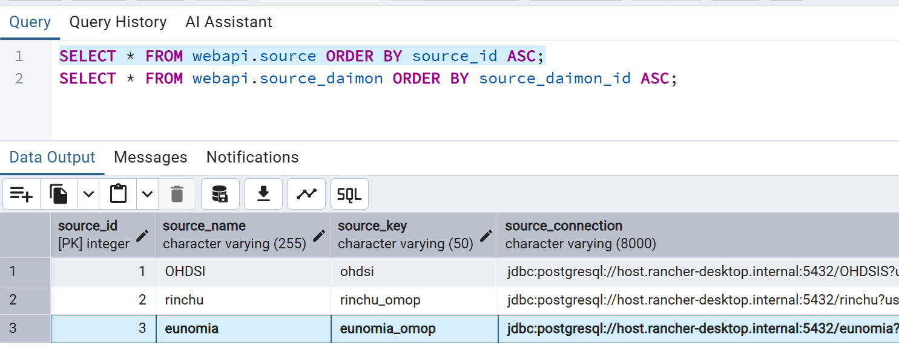
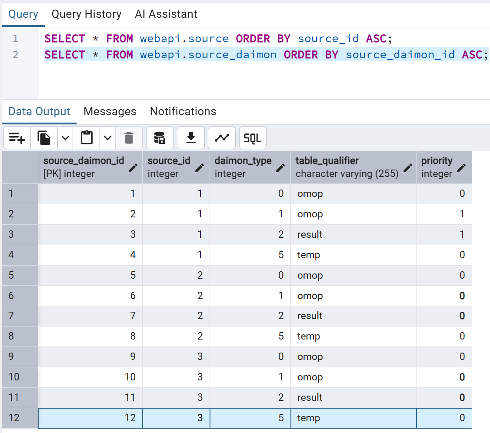

# WebAPIへの複数データソース登録手順

## 1. 目的と仕組み

既存のデータソースを残したまま、WebAPIに新しいOMOP CDMデータソースを追加し、Atlasから選択できるようにします。本手順は、本配布環境のPostgreSQL接続を対象とします。

本手順では、データソースを1つ追加する例を解説します。さらに追加する場合も、未使用のIDとキーを決めて同じ手順を繰り返します。

WebAPIは、次の2つのテーブルを組み合わせて分析対象の接続先を管理します。

| テーブル | 役割 | 登録単位 |
|---|---|---|
| `webapi.source` | データソースの識別情報とDB接続情報を保持する | データソースごとに1行 |
| `webapi.source_daimon` | その接続先で、用途別にどのスキーマを使うかを保持する | データソースごとに複数行 |

両テーブルは `source_id` で関連付けます。同じDBの別スキーマを登録する場合も、別サーバーのDBを登録する場合も、新しいデータソースとして識別するために別の `source_id` と `source_key` を使用します。

**登録先と接続先の違い**

- **登録先**: WebAPI Application Database。本配布環境では、`omopdb` コンテナの `OHDSI` データベース内にある `webapi` スキーマです。以下の登録用SQLはここで実行します。
- **接続先**: 新たに分析対象とするOMOP CDMのDB。接続文字列とスキーマ名を登録することでWebAPIから参照します。登録操作だけでは、CDMテーブルの作成や患者データの投入は行われません。

## 2. 作業の流れと前提

1. 登録済みのIDを確認し、新しく使うIDを決める。
2. `webapi.source` に新しい接続情報を登録する。
3. `webapi.source_daimon` に用途別のスキーマ情報を登録する。
4. WebAPIコンテナを再起動する。
5. WebAPIとAtlasで追加したデータソースを確認する。

### 事前に準備する情報

| 項目 | 確認内容 |
|---|---|
| DB接続先 | WebAPIコンテナから到達できるホスト名、ポート、DB名 |
| 認証情報 | 接続先DBのユーザー名、パスワード |
| CDMスキーマ | OMOP CDMテーブルが格納されたスキーマ名 |
| Vocabularyスキーマ | `concept` 等のVocabularyテーブルが格納されたスキーマ名 |
| Resultsスキーマ | コホート生成等の結果を格納する、必要な結果テーブルが準備済みのスキーマ名 |
| Tempスキーマ | 一時作業用のスキーマ名 |
| 権限 | 登録先へのINSERT権限、および接続先でのCDM・Vocabularyの参照権限、Results・Tempで必要な作成・更新権限 |

WebAPIとDBが起動していることを確認してください。再起動は利用者に影響するため、解析・コホート生成等が実行中でない時間帯に実施します。登録前に既存の登録情報をバックアップし、作業中は他の担当者によるデータソース登録を行わないでください。

> [!WARNING]
> 配布されている `webapi_sources_sample_localdb.sql` と `webapi_sources_sample_containerdb.sql` は初期化用です。先頭に既存登録を削除する `TRUNCATE` があるため、追加登録のためにそのまま実行しないでください。本手順では既存行を削除・更新せず、新規行だけを追加します。

> [!NOTE]
> サンプルSQLは参考例です。今回使用するIDが未使用であることを確認し、接続情報とスキーマ名を実環境に合わせた実行用SQLを作成してください。認証情報を含むSQL・画面キャプチャは共有前にマスキングしてください。

## 3. 登録済みIDの確認

### 3.1 Query Toolを開く

1. pgAdmin（http://localhost:15050/pgadmin）を開きます。
2. 左ペインで **Servers → omopdb_docker → Databases → OHDSI** を選択します。
3. **Query Tool** を開きます。

<!-- 画面キャプチャ挿入位置: OHDSIデータベースを選択してQuery Toolを開いた画面 -->

### 3.2 既存の登録を確認する

**目的**: 既存のデータソースを識別し、IDやキーの重複を避けます。

```sql
SELECT * FROM webapi.source ORDER BY source_id ASC;

SELECT * FROM webapi.source_daimon ORDER BY source_daimon_id ASC;
```

それぞれのSQLを実行し、結果を最終行まで表示します。IDの昇順に並ぶため、`webapi.source` の最終行で `source_id` の最大値、`webapi.source_daimon` の最終行で `source_daimon_id` の最大値を確認できます。追加するIDは、それぞれの最大値より大きい値にします。結果が0行の場合は `1` から採番します。

以下の画面キャプチャは、データソースが3つ登録されている場合の確認例です。実際の登録状況は環境によって異なるため、お使いの環境の実行結果で最大IDを確認してください。





削除扱いの行（`deleted_date` に値がある行）も含めて確認し、既存のIDは再利用しません。

### 3.3 新規登録用の値を決める

以降のサンプルSQLは、データソースがすでに `source_id = 1` で1つ登録されており、次のデータソースを `source_id = 2` として追加する例です。3.2の画面キャプチャに示した3つ登録済みの環境とは前提が異なります。

既存の `source_daimon_id = 1～4` も使用済みであると想定し、追加するデータソースには次の値を使用しています。今回作成する実行用SQLでは、3.2で確認した実際の最大IDより大きい値を使用し、関連する値をすべてそろえてください。

| 項目 | 追加DB | 決め方 |
|---|---|---|
| `source_id` | `2` | `webapi.source` 内で未使用の整数 |
| `source_name` | `Additional OMOP DB` | Atlas上で区別しやすい表示名 |
| `source_key` | `additional_omopdb` | 既存と重複しない、空白を含まない識別文字列 |
| `source_daimon_id` | `5～8` | `webapi.source_daimon` 全体で未使用の整数を4つ |

> [!IMPORTANT]
> **`source_daimon_id` はデータソースごとに1から振り直す番号ではありません。別のデータソースの行とも重複しない値にします。**

## 4. 接続情報の登録（webapi.source）

**目的**: WebAPIが新しいDBへ接続できるように、識別情報とJDBC接続文字列を登録します。この段階では用途別のスキーマは未登録です。

### 4.1 接続文字列を記述する

PostgreSQLの接続文字列は、次の形式です。

```text
jdbc:postgresql://<ホスト名>:<ポート>/<DB名>?user=<DBユーザー>&password=<DBパスワード>
```

| 接続先 | WebAPIコンテナから見たホスト名・ポートの例 |
|---|---|
| Rancher DesktopのホストPC上のDB | `host.rancher-desktop.internal:5432` |
| Docker DesktopのホストPC上のDB | `host.docker.internal:5432` |
| 本配布環境のomopdbコンテナ | `omopdb:5432`（ホスト公開ポートの15432ではない） |
| 院内の別DBサーバー | そのサーバーのDNS名またはIPアドレスとDBポート |

### 4.2 SQLを実行する

登録するIDと接続先が決まったら、[webapi_sources_sample_add_one.sql](../webapi_setting/webapi_sources_sample_add_one.sql)を参考に、今回実行するSQLを作成します。このファイルは、既存の登録を残したまま1つのデータソースを追加する参考例です。サンプルファイル自体は変更せず、今回登録するデータソースのID・接続情報・スキーマ名に合わせて実行用SQLを作成してください。

以下では、サンプルの接続情報登録部分を解説します。スキーマ情報登録部分は手順5で解説します。サンプルや本文のSQL例をそのまま実行するのではなく、作成した実行用SQLを使用してください。

サンプルSQLの `INSERT INTO webapi.source` は、1つの追加DBの接続情報を登録します。`REPLACE_WITH_DB_HOST`・`REPLACE_WITH_DB_PORT`・`REPLACE_WITH_DB_NAME`・`REPLACE_WITH_DB_USER`・`REPLACE_WITH_DB_PASSWORD` を実環境の値に置き換えます。

Query Toolの **Auto commit（自動コミット）をオン** にして実行します。本手順では、成功したSQLはその都度確定されます。

```sql
INSERT INTO webapi.source (
    source_id,
    source_name,
    source_key,
    source_connection,
    source_dialect,
    username,
    password,
    krb_auth_method,
    keytab_name,
    krb_keytab,
    krb_admin_server,
    deleted_date,
    created_by_id,
    created_date,
    modified_by_id,
    modified_date,
    is_cache_enabled,
    check_connection
) VALUES (
    2,
    'Additional OMOP DB',
    'additional_omopdb',
    'jdbc:postgresql://REPLACE_WITH_DB_HOST:REPLACE_WITH_DB_PORT/REPLACE_WITH_DB_NAME?user=REPLACE_WITH_DB_USER&password=REPLACE_WITH_DB_PASSWORD',
    'postgresql',
    '', '', 'PASSWORD', '', '', '',
    NULL, NULL, NOW(), NULL, NOW(), false, true
);
```

作成した実行用SQLをQuery Toolに貼り付け、接続情報登録のINSERT文だけを選択して実行（`F5`）します。INSERTが成功したことをMessagesで確認してください。以降も対象のSQL文を選択して実行し、SQL全体を一括実行しないでください。

<!-- 画面キャプチャ挿入位置: 認証情報をマスキングしたsource登録SQLと実行成功メッセージ -->

## 5. スキーマ情報の登録（webapi.source_daimon）

**目的**: 追加した接続先で、CDM・Vocabulary・Results・Tempとして使うスキーマを指定します。WebAPIは `source_id` で接続情報を取得し、`daimon_type` ごとに `table_qualifier` のスキーマを使い分けます。

### 5.1 用途とスキーマ名を確認する

以下は配布サンプル（ホストDB向け）のスキーマ構成を基に、既存DBのVocabularyを引き続き優先する設定例です。既存DBのVocabulary行の `priority` が `1` であることを前提に、追加DBのVocabulary行は `0` にしています。実際の接続先に存在するスキーマ名を指定してください。

| `daimon_type` | 用途 | `table_qualifier` の例 | `priority` の例 |
|---|---|---|---|
| `0` | CDM：患者・診療情報 | `omop` | `0` |
| `1` | Vocabulary：コンセプト・語彙情報 | `omop` | `0` |
| `2` | Results：コホート生成等の結果 | `result` | `0` |
| `5` | Temp：一時作業領域 | `temp` | `0` |

CDMとVocabularyが同じスキーマにあっても、用途が異なるため別々の行で登録します。Vocabularyが `vocab` スキーマにある場合は、`daimon_type = 1` の行を `vocab` に変更します。

#### priorityの意味と設定方法

`priority` は、WebAPIが用途ごとの優先接続先を選ぶ際の優先度です。同じ `daimon_type` の行をデータソース間で比較し、値が大きいものから、利用権限・接続確認の条件を満たす接続先を選びます。Atlasで明示的に選択した解析対象DBを、この値で勝手に切り替える設定ではありません。

代表的な用途は、**データソースを指定しないVocabulary検索で、どのDBの語彙を使うかを決めること**です。例えば、既存DBと追加DBの両方にVocabularyがある場合、`daimon_type = 1` の行の `priority` で既定の参照先を決めます。

以下はVocabulary行だけの設定例です。他にもデータソースがある場合は、そのVocabulary行の値も含めて確認してください。

| 運用方針 | 既存DBのpriority | 追加DBのpriority |
|---|---|---|
| 今までどおり既存DBのVocabularyを優先する（本手順の例） | `1` | `0` |
| 追加DBのVocabularyを優先する | `0` | `1` |
| 両方とも同じ値にする | `1` | `1` |

> [!IMPORTANT]
> **同順位の場合、どちらが選ばれるかは保証されません。** 既定のVocabulary参照先を決めたい場合は、同順位にしないでください。

`2` なども指定でき、大きい値ほど優先されます。ただし、通常は優先するものを `1`、それ以外を `0` とすると分かりやすくなります。`0` は無効という意味ではなく、優先する接続先が利用できない場合には選ばれる可能性があります。

本手順では、既存環境のVocabulary検索先を変えず、分析対象DBだけを追加する想定のため、追加DBのVocabulary行を `priority = 0` にしています。Vocabularyの優先先を変えるために、CDM・Results・Tempの値まで一緒に変更する必要はありません。データソースを明示的に指定した処理は、そのデータソースに登録したスキーマを使用します。

なお、Results（`daimon_type = 2`）の `priority` は、コンセプト件数キャッシュの事前生成にも影響します。事前生成を有効にしている場合、`priority > 0` が実行条件の一つになります。本例の `0` でも、ATLASから件数を要求した際に未登録のキャッシュは作成されるため、通常の件数表示は利用できます。

実装上の根拠（WebAPI v2.15.1）:

- [SourceRepository：用途ごとにpriorityの降順で取得](https://github.com/OHDSI/WebAPI/blob/v2.15.1/src/main/java/org/ohdsi/webapi/source/SourceRepository.java)
- [SourceService：利用可能な優先接続先を選択](https://github.com/OHDSI/WebAPI/blob/v2.15.1/src/main/java/org/ohdsi/webapi/source/SourceService.java)
- [VocabularyService：データソース未指定時に優先Vocabularyを使用](https://github.com/OHDSI/WebAPI/blob/v2.15.1/src/main/java/org/ohdsi/webapi/service/VocabularyService.java)
- [CDMResultsService：Resultsのpriorityに応じた件数キャッシュの事前生成](https://github.com/OHDSI/WebAPI/blob/v2.15.1/src/main/java/org/ohdsi/webapi/service/CDMResultsService.java)

> [!NOTE]
> `table_qualifier` は、追加するDBの各用途に対応する実際のスキーマ名に合わせて変更してください。

### 5.2 スキーマ情報を登録する

サンプルSQLの `INSERT INTO webapi.source_daimon` は、1つの追加DBに4用途、合計4行のスキーマ情報を登録します。これを参考に、今回登録するデータソースに対応する実行用SQLを作成します。各行の `source_id` は手順4で実際に登録した値にそろえてください。同じQuery Toolで、作成したINSERT文を選択して実行します。

```sql
INSERT INTO webapi.source_daimon (
    source_daimon_id,
    source_id,
    daimon_type,
    table_qualifier,
    priority
) VALUES
    (5, 2, 0, 'omop',   0),
    (6, 2, 1, 'omop',   0),
    (7, 2, 2, 'result', 0),
    (8, 2, 5, 'temp',   0);
```

<!-- 画面キャプチャ挿入位置: source_daimonのINSERT実行成功メッセージ -->

### 5.3 登録内容を確認する

Query Toolで以下のSQLをそれぞれ実行し、追加したデータソースの接続情報とスキーマ情報が登録されていることを確認します。

```sql
SELECT * FROM webapi.source;

SELECT * FROM webapi.source_daimon;
```

本例では、`webapi.source` に `source_id = 2` の1行、`webapi.source_daimon` に同じ `source_id` の4行が追加され、ID・接続情報・スキーマ名・priorityが指定どおりであることを確認します。

> [!WARNING]
> 手順4～5でSQLエラーが発生しても、それ以前に成功した登録は残ります。既存の登録を確認し、原因を修正して失敗したSQLだけを再実行してください。成功済みのINSERTをそのまま再実行するとID重複エラーになります。登録済みの内容に誤りがある場合は、管理者に修正を依頼してください。

## 6. WebAPIコンテナの再起動

**目的**: DBに登録したデータソース情報を、WebAPIに再読み込みさせます。DBへのINSERTだけでは稼働中のWebAPIに反映されない場合があるため、本手順では再起動して反映します。

1. Query Toolで接続情報・スキーマ情報の登録が成功していることを確認します。
2. エクスプローラーで作業フォルダ（`8000_ohdsi_tools_docker`）を開きます。
3. `controller_restart.bat` をダブルクリックして実行します。
4. バッチ画面で再起動処理の完了を確認し、手順7の動作確認に進みます。

配置先の例: `C:\ohdsi_tools_docker\8000_ohdsi_tools_docker\controller_restart.bat`

<!-- 画面キャプチャ挿入位置: controller_restart.batの実行と再起動処理の完了画面 -->

> [!NOTE]
> `controller_restart.bat` はWebAPIだけでなく、全コンテナを再起動します。他の利用者による解析・コホート生成等が実行中でないことを確認してから実施してください。

## 7. 登録後の動作確認

### 7.1 WebAPIの確認

1. http://localhost:18080/WebAPI/info を開き、バージョン情報が返ることを確認します。
2. http://localhost:18080/WebAPI/source/sources を開き、既存データソースに加えて、新しい `sourceId`・`sourceName`・`sourceKey` が表示されることを確認します。ポータルの **WebAPI → Data Sources** からも確認できます。

<!-- 画面キャプチャ挿入位置: 既存と追加データソースが並ぶWebAPIの応答 -->

### 7.2 Atlasの確認

1. http://localhost:18081/atlas を開き、既に開いていた場合は再読み込み（`F5`）します。
2. **Data Sources** で既存データソースと追加データソースを選択できることを確認します。
3. 追加データソースについて、施設で許可された範囲のCDM参照や小規模なコホート生成を行い、接続・参照・結果書き込みができることを確認します。

Data Sourcesのダッシュボードには、接続先にAchillesの集計結果が必要です。データソースが一覧に出ることと、ダッシュボードに統計情報が表示されることは別の確認事項です。

<!-- 画面キャプチャ挿入位置: Atlasのデータソース選択欄と追加データソースの確認画面 -->

## 8. うまくいかない場合

| 症状 | 主な確認点 |
|---|---|
| INSERT時にID重複エラーになる | `source_id`・`source_daimon_id`・`source_key` が既存登録と重複していないか、成功済みのSQLを再実行していないか。登録状況とIDを確認する |
| WebAPIに追加分が表示されない | 正しいWebAPI Application Databaseに接続情報・スキーマ情報が登録されているか、WebAPIを再起動したか、`deleted_date` がNULLか |
| WebAPIの起動・接続でエラーになる | JDBC URL、認証情報、ホスト名、ポート、DB名、ネットワーク到達性、PostgreSQL側の接続許可 |
| Atlasでテーブル未検出や権限エラーになる | `daimon_type` とスキーマ名の対応、必要なテーブルの存在、接続ユーザーの権限 |
| コホート生成が失敗する | Results・Tempの準備状況と権限、接続先のCDM・Vocabularyの整合性 |

WebAPIのログは、作業フォルダで以下のコマンドを実行して確認します。ログに認証情報等が含まれる場合は、共有前にマスキングしてください。

```cmd
docker compose logs --tail 100 webapi
```

## 関連資料

- [利用者向けドキュメント](for_user.md)：起動・pgAdmin・Atlasの基本操作
- [管理者向けドキュメント](for_administrator.md)：環境設定の詳細
- [ホストDB向け初期登録SQL](../webapi_setting/webapi_sources_sample_localdb.sql)：列構成の参照用。追加登録時は初期化処理を実行しないこと
- [コンテナDB向け初期登録SQL](../webapi_setting/webapi_sources_sample_containerdb.sql)：接続先・スキーマ構成の参照用。同上